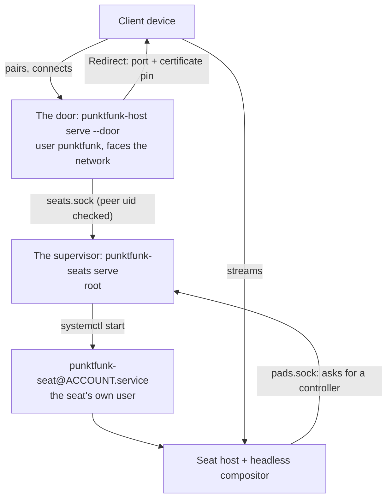

# pf-seats

One machine, several players at once, each on a desktop of their own. This crate is the
**seat supervisor**: the privileged part that creates those desktops, starts and stops them,
and keeps them apart.

Read this page first. It tells you who runs as whom and where each job lives, in plain words.
The exact rules are on the docs site under
[Multi-seat](../../../docs-site/content/docs/developers/multi-seat-contract/index.md); the
words are defined in [`CONTEXT.md`](../../../CONTEXT.md#seats).

## The idea

A **seat** is a second desktop on the same machine: its own OS account, its own session, and an
ordinary `punktfunk-host serve` of its own (the **seat host**). The **supervisor** starts and
stops seat hosts, up to four. It keeps one saved record per seat, a **row**, in its **ledger**.

A seat here is not logind's seat. Where the code means logind's, it says so.

There are three kinds of row. They differ in whose account the seat runs on, and so in what the
supervisor may do to that account:

| Kind | The account | The supervisor may |
|---|---|---|
| Made seat | One the supervisor created for the seat | Create it, delete it, end every process it runs |
| The owner's row (Linux) | The box owner's own login | Start and stop the seat's unit, nothing else |
| A person's row | Someone else's existing login | The same, and only after that person's password or device key |

## Linux: who runs as whom

- **The door** is the box's own host as a system service. It pairs devices and sends each
  player to their seat's port. It never streams and holds no root rights.
- **The supervisor** is the root daemon in `crates/host/punktfunk-seats`, which links this
  crate. It answers the door on a Unix socket and checks the caller's uid with `SO_PEERCRED`.
- **A seat** is one systemd unit per account. Its host runs as the seat's user.

Root does a few jobs in short-lived helpers instead of in the daemon, each for one reason:

| Verb (`punktfunk-seats …`) | Runs as | Why it is its own process |
|---|---|---|
| `pam-check` | root, empty environment | Keeps libpam out of the daemon |
| `login` | root, then the person | Must be the unit's main process to open a real login session |
| `mount-share` | root, in PID 1's mount namespace | The daemon has no `CAP_SYS_ADMIN`; mounts happen here |
| `loopback` | root | Attaches the per-seat loopback address after the unit starts |
| `node-owner` | root, from udev | udev runs it for each device node |
| `serve-usb` | root, in a scope of its own | A seat's USB pad survives a daemon restart |
| `door on\|off\|ports` | root | Works while the daemon is stopped |

## Linux: one made seat starting

1. The door sends `Start` on `seats.sock`. `service.rs` checks the row and takes the lifecycle
   lock.
2. `linux/mod.rs` readies the account: its group, its home, the shared games folder.
3. Before the unit: the seat's copies of the box's files are written, lent controllers go to
   the seat, and its `/dev/uinput` stand-in comes up.
4. A fresh management token, the seat's environment file and its unit drop-ins are written
   under `/run`. Then `systemctl start punktfunk-seat@<account>`.
5. systemd logs the user in and runs `seat-session`: a headless compositor and the seat host.
6. After the unit: the pad broker starts serving the seat's user.
7. The supervisor waits, up to 90 seconds, until the seat's own user holds the management port.

A stop runs the same steps backwards. A restart of the supervisor reads each unit's state back
from systemd; seats keep running meanwhile.

## Linux: what is on disk

| Path | What | Who reads it |
|---|---|---|
| `/var/lib/punktfunk` | The door's directory: identity, pairing store, profiles | The door |
| `/var/lib/punktfunk-seats/seats/ledger.json` | The ledger | root |
| `/var/lib/punktfunk-seats/seats/password-failures.json` | Each account's recent wrong passwords, kept across a restart | root |
| `/var/lib/punktfunk-seats/seats/<id>/` | A made seat's home and private folders | That seat |
| `/var/lib/punktfunk-seats/trust/<id>/` | The seat's read-only copy of the box's pairing store and profiles | That seat |
| `/var/lib/punktfunk-seats/library/` | Root's copy of the owner's game library | The door, every seat's copy |
| `/var/lib/punktfunk-seats/games/` | One Steam library every seat shares | Every seat |
| `/run/punktfunk/seats/<account>.env` | The environment a seat host starts with | That seat |
| `/run/punktfunk/seats.sock`, `pads.sock` | The supervisor's sockets | The door; running seats |

## Windows

The supervisor runs inside the LocalSystem `PunktfunkHost` service and is reached over a named
pipe. A seat is a loopback Remote Desktop session of the seat's account. A small RDP client,
the **keeper** (`crates/host/pf-seat-keeper`), signs the account in and keeps the session up.
The seat host then runs in that session.

`windows/step.rs` holds the whole lifecycle as a pure function: state and one observation in,
actions out. `windows/supervisor.rs` performs the actions. Start with `step.rs`.

## Where things are

| File | What it is |
|---|---|
| `model.rs` | The ledger and its rows; every value checked again when it is loaded |
| `service.rs` | One command at a time: checks the row, saves the ledger, calls the platform |
| `backend.rs` | The trait a platform implements (`provision`, `start`, `stop`, `remove`, …) |
| `ipc.rs` | The frames on the socket or pipe, and the `Command` list |
| `persistence.rs` | Crash-safe, link-safe file writes under the supervisor's root |
| `unlock.rs`, `attempts.rs` | Who may open a person's seat, and the limit on wrong passwords |
| `profile_locks.rs` | Which devices may open each profile: PINs and device keys |
| `linux/mod.rs` | The Linux platform: start, stop, delete, and the two-second sync thread |
| `linux/resources.rs` | The table of what must be up while a seat's unit runs, and when it starts and stops |
| `linux/session.rs` | Everything systemd reads for a seat: environment file, drop-ins |
| `linux/accounts.rs` | Seat users: created, checked by their marker, removed |
| `linux/layout.rs` | Where each folder under the state directory is, and how it is made |
| `linux/acl.rs` | POSIX ACL bytes, and the walk that keeps the games folder writable |
| `linux/trust_copy.rs` | A seat's trust copy of the box's pairing store, and the copy of its host's certificate |
| `linux/library_copy.rs` | The box library, and each seat's copy of it |
| `linux/steam_home.rs` | A seat's Steam in its home: cloned, linked, given a library list |
| `linux/libraries.rs`, `mount_share.rs` | The owner's Steam libraries, mounted into a seat |
| `linux/node_owner.rs`, `lent.rs` | Which user owns a controller's device nodes |
| `linux/pam.rs`, `login.rs`, `login_password.rs` | A person's password: checked, then used for one login |
| `linux/door_switch.rs` | The root verb that switches the door on and off |
| `linux/safe_open.rs` | How root reads files in a folder another user can write |
| `linux/copy_lock.rs` | The lock every writer of a seat's copied files takes |
| `windows/backend.rs` | `WindowsBackend`: the portable commands, carried out on Windows |
| `windows/step.rs`, `supervisor.rs` | A Windows seat's lifecycle: the rule, and the OS side |
| `windows/lent.rs`, `doctor.rs` | Lent controllers per session; the rows of the seat check |
| `windows/accounts.rs`, `credentials.rs` | Seat accounts and their sealed passwords |
| `windows/enable.rs`, `switch.rs` | Turning seats on and off for the machine |

## Running the tests

- `cargo test -p pf-seats` runs the portable tests and the Linux tables on any Unix.
- The tests that start a seat for real need root and are `#[ignore]`d:
  `cargo test -p pf-seats --lib -- --ignored start_tests` in a Linux container as root.
- `crates/host/punktfunk-seats` builds on Linux only.
