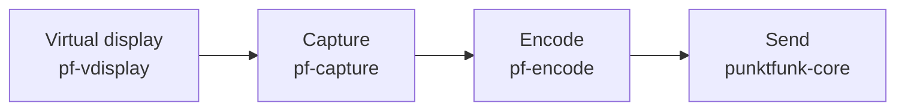
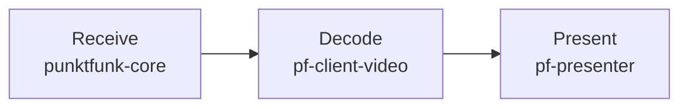
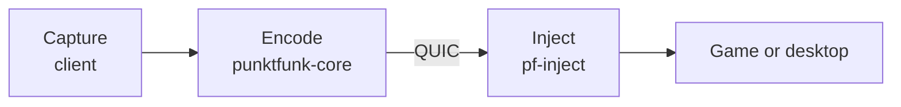
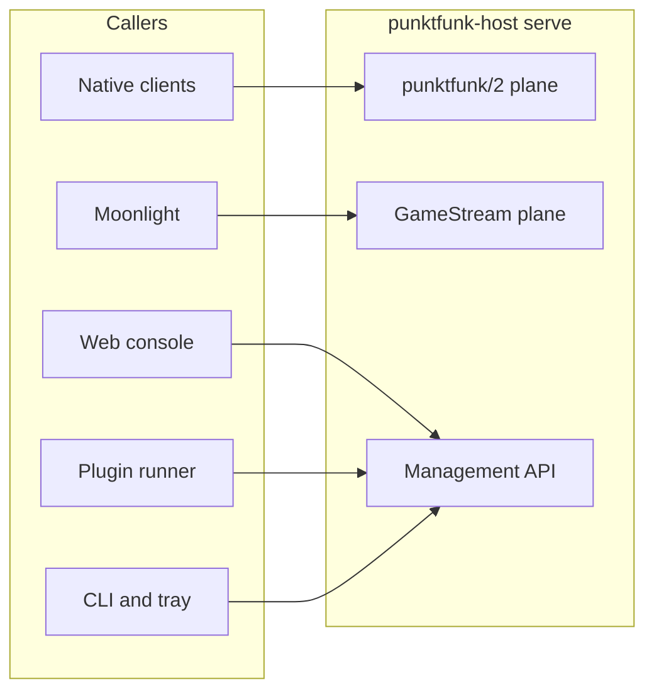

Follow a frame from the host's GPU to a client's screen and an input event back, see which
processes do the work, and learn the rules a change must keep. What crosses the network is on
[How a session works](/docs/developers/sessions); which directory holds what is on the
[Code map](/docs/developers/code-map). The user-level version is [How it works](/docs/how-it-works).

## A frame, host to glass

Every session gets its own virtual display at the client's resolution and refresh rate. A frame
never leaves the GPU on its way to the encoder, and never enters an async runtime on its way to
the wire.

| Stage | What happens | Crates |
|---|---|---|
| Virtual display | The client's hello names `WxH@Hz`. The host creates an output at that mode and removes it when the client leaves. | `pf-vdisplay` |
| Capture | The frame arrives as a GPU buffer, not as pixels in memory. | `pf-capture`, `pf-zerocopy` |
| Encode | One backend turns it into an access unit: one encoded frame. | `pf-encode`, `pf-encode-win`, `pf-encode-core` |
| Send | The access unit is split into packets, given error correction, sealed and paced onto UDP. | `punktfunk-core` |
| Receive | Packets are opened, reordered and repaired back into the access unit. | `punktfunk-core`, `pf-client-core` |
| Decode | A ladder tries the platform's hardware decoder first, then a CPU decoder. | `pf-client-video`, `pf-vkdecode`, `pf-vaapi`, `pf-v4l2dec`, `pf-dxvadec`, `pf-bitstream` |
| Present | The picture is drawn at the display's own cadence, with the overlay on top. | `pf-presenter`, `pf-console-ui` |

Audio rides the same session: desktop audio goes to the client as Opus, the client's microphone
comes back.

### The same pipeline on each host

| | Linux | Windows | macOS |
|---|---|---|---|
| Virtual display | The compositor's own: KWin, Mutter, Hyprland, niri, Umbriel, mango, wlroots, gamescope | The `pf-vdisplay` IddCx driver | `CGVirtualDisplay` where macOS has it, else a mirror of the main display |
| Capture | dmabufs over `ext-image-copy-capture-v1`, else PipeWire | The driver pushes frames; Windows Graphics Capture for a mirrored or shared screen | ScreenCaptureKit |
| Encode | NVENC, Vulkan Video, VAAPI, PyroWave, software openh264 | NVENC, AMF, QSV, Media Foundation, PyroWave, inside the driver's process | VideoToolbox |
| Input | libei, KWin fake input, or the wlroots virtual pointer and keyboard; pads over uhid or USB/IP | A UMDF HID mouse and keyboard, `SendInput` for text; UMDF gamepads | CoreGraphics events; pads as `IOHIDUserDevice` |
| Audio | A PipeWire sink the host owns | WASAPI loopback | A Core Audio process tap |

Each compositor keeps its own backend behind the `VirtualDisplay` trait, and each encoder sits
behind `Encoder`. `PUNKTFUNK_ENCODER` pins a backend.

On Windows the driver encodes inside WUDFHost and hands access units to the host through a
shared section. `crates/host/pf-driver-proto` defines that contract, and the host refuses a
driver older than `MIN_DRIVER_PROTOCOL_VERSION`, so the installer ships both together.

### The same pipeline on each client

| Client | Decode | Present |
|---|---|---|
| Linux, Windows | Vulkan Video, VAAPI, V4L2 or D3D11VA, then CPU openh264 or rav1d. PyroWave decodes in Vulkan compute. | An SDL3 window with a Vulkan swapchain, and a Skia overlay |
| Apple | VideoToolbox | Metal |
| Android | `AMediaCodec` | A `SurfaceView` |

The Linux and Windows apps are thin shells: each starts `punktfunk-session`, which owns the
stream window. Apple and Android link `punktfunk-core` into their own apps.

## An input event, glass to host

1. The client captures keyboard, mouse, touch, pen and gamepads.
2. `punktfunk-core` sends them over the QUIC connection: motion and stick positions as datagrams
   where the newest wins, key and button presses on the reliable control stream.
3. The host hands them to `pf-inject`, which makes them real input for the session's desktop.
4. Rumble, lights and other controller feedback go back to the client on the same connection.

## What runs on a host

| Process | Does |
|---|---|
| `punktfunk-host serve` | Every session, both protocols, the management API, the game library |
| `punktfunk-encode-worker` | Linux: PyroWave and the NVIDIA frame convert, at raised GPU priority |
| `punktfunk-capture-worker` | Windows: capture and encode of a mirrored or shared screen, as the signed-in user |
| The UMDF drivers | Windows: the virtual display, which also encodes, plus gamepads, mouse and touchpad |
| The web console (`web/`) | The admin UI, on Bun. Its server holds the admin token and proxies `/api/**`, so the token never reaches the browser |
| The plugin runner (`sdk/`) | Each plugin in a sandbox of its own, on Bun |
| `punktfunk-tray` | The status icon |
| `punktfunk-seats` | Linux: a root daemon that starts one host per seat ([Multi-seat](/docs/developers/multi-seat-contract)) |

## Two protocols

Both run in one `punktfunk-host serve` process.

| | `punktfunk/2` | GameStream |
|---|---|---|
| Clients | The native clients | Moonlight |
| On | Always | `serve --gamestream`, trusted LAN only |
| Control | QUIC: pairing, mode changes, clock sync, adaptive bitrate, clipboard | HTTPS pairing, RTSP, ENet |
| Video | Raw UDP on the QUIC port, GF(2¹⁶) Leopard FEC, up to 65535 shards a block | UDP, GF(2⁸) Reed–Solomon FEC, at most 255 shards a block |
| Discovery | mDNS `_punktfunk._udp` | mDNS `_nvstream._tcp` |
| Code | `punktfunk-core`, `punktfunk-host/src/native*` | `punktfunk-host/src/gamestream` |

`--webtransport` adds a third plane, which serves `punktfunk/2` to the browser client at `/pf2`.
`--no-default-features --features pyrowave` builds a host without the GameStream code. Port
numbers: [Ports](/docs/ports).

## Rules every change keeps

- **One core, linked everywhere.** Protocol, FEC and crypto live once in `punktfunk-core`. Other
  languages reach it through a versioned C ABI, `punktfunk-ffi`.
- **No async on the hot path.** The per-frame pipeline runs on native threads. `tokio` and
  `quinn` sit behind the `quic` feature and serve the control plane only.
- **The virtual display runs at the client's mode.** The host scales the picture only when the
  client names a smaller view than its mode. Any other scaling happens in the client's presenter.
- **Host and client never depend on each other.** `crates/core` and `crates/codec` serve both
  sides; `scripts/ci/check-crate-groups.py` fails CI on a `client` crate that pulls in a `host`
  one, or the reverse.
- **Each version moves alone.** The ALPN (`pkf2`) versions the wire, `ABI_VERSION` the C
  surface, and `PROTOCOL_VERSION` in `pf-driver-proto` the Windows driver. Never ride one bump on
  another.
- **Resolve once.** A session decides its encoder backend once, at the handshake, and every
  rebuild inside it reads that value. The capture and encode crates read each `PUNKTFUNK_*`
  switch in one file, once per open.
- **Model and shell.** A decision that has needed more than one fix becomes a pure model: an
  enum state, a `step` from an observation to actions, and a table test whose rows name the
  fixes they pin. The shell around it samples the OS and executes the actions.

The reasoning behind the last two, and behind the capture contract, is in
[`docs/adr/`](https://git.unom.io/unom/punktfunk/src/branch/main/docs/adr).
