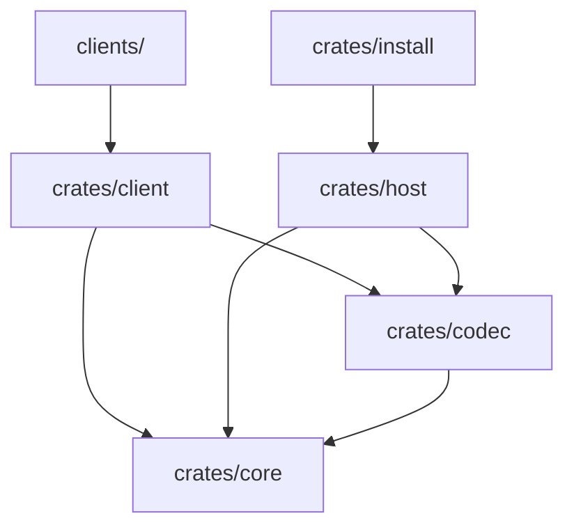

Find the directory a change belongs in. Rust crates sit in `crates/<group>/`, the apps people
install in `clients/`, and everything written in TypeScript at the top level.

A group may also use what the groups below it use. `client` and `host` never depend on each
other; `scripts/ci/check-crate-groups.py` fails CI if one does.

## Where to start

| To change | Start in |
|---|---|
| A message or number on the wire | `crates/core/punktfunk-core/src/quic/`; every number is in `quic/v2/registry.rs` |
| Packets, error correction or encryption | `crates/core/punktfunk-core/src/{packet,fec,crypto.rs}` |
| What a session does on the host | `crates/host/punktfunk-host/src/native.rs` and `native/` |
| Support for another compositor | `crates/host/pf-vdisplay`, one backend per compositor behind `VirtualDisplay` |
| An encoder backend | `crates/host/pf-encode`; the `Encoder` trait is in `pf-encode-core` |
| A capture source | `crates/host/pf-capture`; the contract is `docs/adr/0001` |
| How input reaches the desktop | `crates/host/pf-inject` |
| A management API route | `crates/host/punktfunk-host/src/mgmt/`, then the [checklist](/docs/developers/management-api#changing-the-api) |
| A host setting | `crates/host/pf-host-config`, the settings registry |
| The web console | `web/` |
| The desktop clients' stream window | `crates/client/pf-presenter`; the overlay and gamepad UI are `pf-console-ui` |
| The decode ladder | `crates/client/pf-client-video` |
| Text a person reads | `l10n/messages`, never a literal in code ([docs/l10n.md](https://git.unom.io/unom/punktfunk/src/branch/main/docs/l10n.md)) |

## Shared by host and clients

| Path | What |
|---|---|
| `crates/core/punktfunk-core` | Wire format, FEC, crypto, pacing and the QUIC control plane (`quic` feature) |
| `crates/core/pf-dmabuf` | dmabuf fence wait and read-only mapping (Linux) |
| `crates/core/pf-update-check` | The signed update manifest |
| `crates/core/pf-fluent` | WinUI theme colours and motion for the Windows client and installer |
| `crates/codec/pf-bitstream` | Access-unit parsing and decode plans for H.264, HEVC and AV1 |
| `crates/codec/pf-vkdecode`, `pf-vaapi`, `pf-dxvadec` | Native decoders: Vulkan Video, VAAPI, D3D11VA |
| `crates/codec/pf-libva` | The libva that the VAAPI decoder and encoder share, loaded at run time |
| `crates/codec/pf-v4l2`, `pf-v4l2dec` | V4L2 decode: the ioctl half, and the decoder flows a CPU can test |
| `crates/codec/pyrowave-sys`, `libvpl-sys` | Vendored PyroWave and Intel VPL, built from source |

## Host

| Path | What |
|---|---|
| `crates/host/punktfunk-host` | The host: sessions, both protocol planes, management API, game library, CLI |
| `crates/host/punktfunk-encode-worker` | Separate binary for PyroWave and the NVIDIA frame convert, at raised GPU priority |
| `crates/host/punktfunk-capture-worker` | Windows Graphics Capture and its encoder, as the signed-in user |
| `crates/host/pf-vdisplay` | Virtual outputs: one backend per compositor, the Windows driver, macOS |
| `crates/host/pf-capture` | Capture behind `Capturer`: PipeWire, direct Wayland, the Windows driver and WGC, ScreenCaptureKit |
| `crates/host/pf-encode-core` | The `Encoder` trait and the policy every backend shares |
| `crates/host/pf-encode`, `pf-encode-win` | Encoder backends: Linux and macOS, Windows |
| `crates/host/pf-encode-session` | Windows: pool slot to encoder to access-unit section, shared by the driver and the capture worker |
| `crates/host/pf-zerocopy` | CUDA, EGL and Vulkan dmabuf import (Linux) |
| `crates/host/pf-inject` | Keyboard, mouse, pen and virtual-gamepad injection |
| `crates/host/pf-audio` | Desktop audio capture, the virtual microphone, pad audio |
| `crates/host/pf-clipboard` | Shared clipboard backends |
| `crates/host/pf-portal` | The one tokio runtime every portal call runs on (Linux) |
| `crates/host/pf-frame`, `pf-gpu`, `pf-win-display` | Frame vocabulary; GPU selection; Windows display topology |
| `crates/host/pf-host-config` | The settings registry, its store and the environment switches |
| `crates/host/pf-paths`, `pf-paths-win` | Config directory and owner-private files; Windows DACL checks |
| `crates/host/pf-driver-proto` | The contract between the host and the Windows drivers |
| `crates/host/pf-seats`, `punktfunk-seats` | The seat supervisor: inside the service on Windows, a root daemon on Linux |
| `crates/host/pf-seat-keeper`, `pf-seat-audio` | A Windows seat's RDP keeper, in a workspace of its own; the seat's audio endpoint DLL |

## Clients

| Path | What |
|---|---|
| `crates/client/punktfunk-ffi` | The C ABI over the core |
| `crates/client/pf-client-core` | Client plumbing: session pump, audio, gamepads, trust, discovery |
| `crates/client/pf-client-video` | Decode ladder, Vulkan device handoff, colour maths, PyroWave decode |
| `crates/client/pf-presenter` | SDL3 window, Vulkan swapchain, input capture |
| `crates/client/pf-console-ui` | The Skia UI: stats overlay, gamepad home, library, settings |
| `clients/session` | `punktfunk-session`, the stream window every desktop front-end starts |
| `clients/linux`, `clients/windows` | The GTK4 and WinUI 3 apps (`punktfunk-client`) |
| `clients/cli` | `punktfunk`, the headless CLI |
| `clients/probe` | `punktfunk-probe`, the reference client and measurement tool |
| `clients/apple` | The Swift app for macOS, iOS, iPadOS, tvOS and visionOS; `native/` is its static library |
| `clients/android` | The Kotlin app for phone and TV; `native/` is its JNI core |
| `clients/decky` | The Steam Deck plugin, which starts the CLI |
| `clients/shared` | Test vectors every client checks against |

The browser, LG webOS, Nintendo Switch and PlayStation 5 clients live in their own repositories
and pin these crates as git dependencies.

## Install and update

| Path | What |
|---|---|
| `crates/install/punktfunk-setup`, `punktfunk-setup-win` | The guided Linux installer that `install.sh` fetches; the Windows installer wizard |
| `crates/install/punktfunk-tray` | The tray status icon |
| `crates/install/pf-update` | The root helper for updates started from the console |
| `packaging/` | apt, rpm, Arch, Flatpak, Bazzite, bootc, Nix, the macOS app, the Windows installer and drivers, winget |

## Web, SDK and plugins

| Path | What |
|---|---|
| `web/` | The web console: TanStack Start, server-rendered on Bun. orval generates its API client from `api/openapi.json`. |
| `sdk/` | `@punktfunk/host`, the TypeScript client for the management API, and the plugin runner `punktfunk-scripting` |
| `plugin-kit/` | `@punktfunk/plugin-kit`, the kit plugins are written with |
| `l10n/` | Every message a person reads, one folder per part under `l10n/messages/` (`web`, `host`, `common` and the clients), and `pf-l10n`, which compiles and checks them |
| `docs-site/` | This site |

## Windows drivers

`packaging/windows/drivers/` is a cargo workspace of its own, built with the WDK.

| Crate | Role |
|---|---|
| `pf-vdisplay` | IddCx virtual display. Encodes in WUDFHost and publishes access units to the host. |
| `pf-gamepad` | HID minidriver that presents the pad the host names: PlayStation, Xbox, Steam, Switch, 8BitDo and Hori models |
| `pf-xusb` | An Xbox 360 pad visible to XInput, with no kernel bus driver |
| `pf-mouse` | Resident virtual HID mouse and keyboard, so Windows draws a cursor on a headless host |
| `pf-touchpad` | A virtual Precision Touchpad per session |
| `wdk-iddcx`, `pf-umdf-util` | IddCx bindings and the safe UMDF layer the drivers share |

`packaging/windows/pf-vkhdr-layer` is a Vulkan layer that lets Vulkan games turn on HDR over the
virtual display.

## Generated, tooling and CI

| Path | What |
|---|---|
| `api/openapi.json`, `include/punktfunk_core.h` | The generated API spec and C header, checked in ([Generated files](/docs/developers/contributing#generated-files)) |
| `tools/` | `gen-headers`, and probes such as `loss-harness`, `scroll-probe`, `cursor-probe`, `wl-scanout-probe`, `wgc-probe` and `display-disturb` |
| `ci/`, `scripts/` | CI builder images; install, packaging and CI scripts |
| `docs/` | House rules for people who change the code: writing, localization, identifiers, settings, and the decision records in `docs/adr/` |
