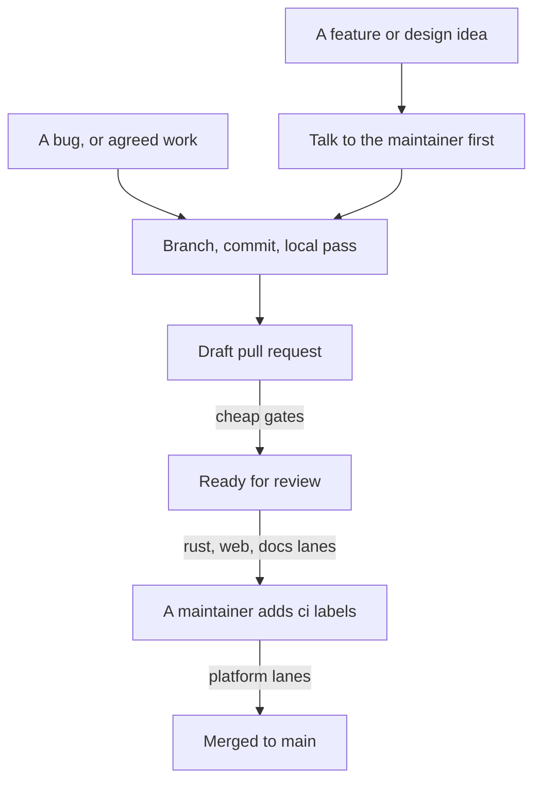

Take a change from your clone into `main`: what to agree first, what to run locally, and which CI
lanes a pull request runs at each stage.



## Before you write code

- **A new feature or design** starts as a conversation with the maintainer, on
  [Discord](https://discord.gg/wzEGg9y45z) or as an idea on
  [improve unom](https://improve.unom.io/p/punktfunk), before any issue or pull request. The
  tracker holds bugs and agreed work.
- **A bug** reported on improve unom gets its tracker issue by itself
  ([Reporting an Issue](/docs/report-an-issue)).
- **A new player-facing setting** needs the maintainer's yes first
  ([docs/settings.md](https://git.unom.io/unom/punktfunk/src/branch/main/docs/settings.md)).
- **A security report** goes to **security@punktfunk.com**, never to an issue.

## Git hooks

Enable the repo hooks once per clone:

```sh
git config core.hooksPath scripts/git-hooks
```

On commit they format your staged Rust and JavaScript, re-stage it, and run the writing gate. A
file with both staged and unstaged edits is refused rather than rewritten. On push they check
rustfmt (main and driver workspaces), Biome, the writing gate and unsafe hygiene, and print the
command that fixes each failure. Biome runs only where `web/` or `plugin-kit/` has `node_modules`.

## The full local pass

Run [the workspace suite](/docs/developers/testing#the-workspace-suite), then the
[checks for what you touched](/docs/developers/testing#checks-by-area). When your local `main`
lags, run the writing gate against the remote:
`WRITING_BASE=origin/main sh scripts/ci/check-writing.sh`.

## Open a pull request

Open it as a draft while you iterate: a `WIP:` title prefix in Gitea. Each lane runs only when the
change touches its paths.

| Pull request is | CI runs |
|---|---|
| A draft | The cheap gates: writing style, docs drift and links, the text census, secret scan, the `bun.nix` check, and the SDK, plugin-kit and Decky checks |
| Ready for review, or labelled `ci:all` | Also `rust`, `rust-arm64`, `web` and `docs-site` |
| Labelled for a platform | Also that [platform lane](#platform-lanes) |
| Merged to `main` | Every `ci.yml` lane; the platform workflows when their own paths change |

Marking a pull request ready or adding a label starts no run by itself: push again, or press
**Re-run** on the latest run in the Actions tab. The installer smoke test, the packaging lint, the
setup binary build, the macOS host compile check and the Windows host lint filter by path alone,
so they run on drafts too.

### Platform lanes

These are label-only; being ready for review isn't enough. Only someone with write access can add
a label.

| Label | Runs |
|---|---|
| `ci:android` | The Android build; attaches the debug APK to the run as a zip |
| `ci:apple` | The Apple client build and tests |
| `ci:windows-client` | The Windows client |
| `ci:windows-host` | The Windows drivers and the setup test |
| `ci:nix-rust` | The Nix flake |
| `ci:all` | Everything above, plus the ready-for-review lanes |

## Generated files

These are checked in, and CI fails when the committed copy drifts:

| File | Regenerate |
|---|---|
| `include/punktfunk_core.h`, `include/punktfunk_console.h` | `cargo run -p gen-headers` |
| `api/openapi.json` | `cargo run -p punktfunk-host -- openapi > api/openapi.json` |
| `docs-site/public/openapi.json` | `cp api/openapi.json docs-site/public/openapi.json` |
| `sdk/src/gen/punktfunk.ts` | `cd sdk && bun run gen` |
| `docs-site/src/data/platforms.json` | `cp data/platforms.json docs-site/src/data/platforms.json` |
| `THIRD-PARTY-NOTICES.txt` (and the clients' copies) | `bash scripts/gen-third-party-notices.sh` |
| `web/bun.nix`, `sdk/bun.nix` | `sh scripts/ci/check-bun-nix.sh --fix` |
| `*.spv` shaders in `pf-zerocopy` and `pf-encode` | `glslangValidator -V <name>.comp -o <name>.spv` |
| Settings table in `configuration.md` | `UPDATE_SETTINGS_DOCS=1 cargo test -p pf-host-config docs_table_is_current` |

A management-API change needs the three OpenAPI rows, and more:
[Changing the API](/docs/developers/management-api#changing-the-api). A `Cargo.lock` change needs
the notices. A new dependency must be permissive; see [Licensing](#licensing).

## Docs

Every user-facing fact has one home, and everything else links to it:

| Surface | Holds | Never holds |
|---|---|---|
| [docs-site](https://docs.punktfunk.unom.io) (`docs-site/content/`) | Every user-facing fact: install, config, features, troubleshooting | Design rationale |
| READMEs | Build notes, traps, and links into the docs | User walkthroughs |
| [punktfunk.unom.io](https://punktfunk.unom.io) (separate repo) | Marketing, downloads, blog | Instructions |

When a change moves a user-facing fact, update the page that owns it in the same pull request. How
to write a page, diagrams included:
[docs/writing.md §4c](https://git.unom.io/unom/punktfunk/src/branch/main/docs/writing.md#4c-docs-pages).

CI checks the textual half:

- `check-docs-drift.sh`: the OpenAPI and `platforms.json` snapshots, the `PUNKTFUNK_*` and
  `PFVD_*` names the docs mention, and the host commands in [Host CLI](/docs/host-cli).
- `check-docs-links.sh`: page links, heading anchors and relative file links.

A new `PUNKTFUNK_*` or `PFVD_*` variable needs a docs mention, or a line in
`scripts/ci/docs-undocumented-env-baseline.txt` in the same commit.

## Writing rules

[docs/writing.md](https://git.unom.io/unom/punktfunk/src/branch/main/docs/writing.md) is the house
style for commits and the pull-request title (§1), the changelog (§2), comments (§3), error messages
(§4) and docs pages (§4c), with a checklist for every pull request (§5).
`scripts/ci/check-writing.sh` enforces the lengths and fails the pull request.

A commit subject is `type(scope): summary`: imperative, at most 72 characters, one change.

## Licensing

Contributions are licensed MIT OR Apache-2.0 (inbound = outbound), copyleft code is never pasted,
and every dependency must be permissive. The terms:
[CONTRIBUTING.md](https://git.unom.io/unom/punktfunk/src/branch/main/CONTRIBUTING.md#licensing-of-contributions-inbound--outbound).
