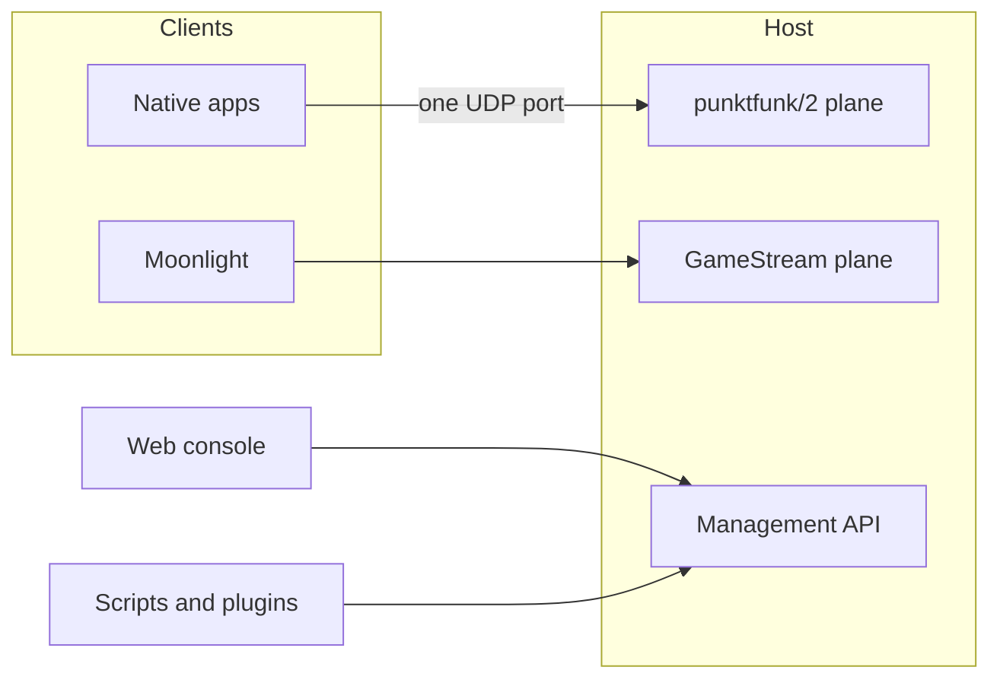

import { Cards, Card } from 'fumadocs-ui/components/card'

Punktfunk is a streaming stack you can read end to end: a host that turns a GPU frame into
packets, one shared core that carries them, and clients that put them on a screen. Start here to
run it from source, change it, or build on it. To install and stream instead, start at the
[Quick start](/docs/quickstart).



The host and every native client link the same Rust crate, `punktfunk-core`, for the protocol.
Everything that manages a host (the web console, the CLI, the tray, plugins) goes through its
REST API.

## First run

A whole session runs on one machine with no GPU and no desktop: the host streams generated
frames, and the probe client checks every byte that arrives. You need Rust from
[rustup](https://rustup.rs), and on Linux the
[workspace packages](/docs/developers/build-from-source#workspace-prerequisites).

```sh
git clone https://git.unom.io/unom/punktfunk.git && cd punktfunk
cargo run -rp punktfunk-host -- punktfunk1-host --source synthetic --allow-tofu
```

In a second terminal:

```sh
cargo run -rp punktfunk-probe -- --connect 127.0.0.1:9777
```

That is the QUIC handshake, sealed video with error correction, and reassembly on the far side.
[How a session works](/docs/developers/sessions) walks through each step, and
[Run and test](/docs/developers/testing) streams a real desktop to a real client.

rustup installs the compiler `rust-toolchain.toml` pins. Don't override it, or rustfmt reformats
files you never touched.

## Pick a path

### Understand it

<Cards>
  <Card title="Architecture" href="/docs/developers/architecture" description="The path of a frame and an input event, what runs on a host, and the rules every change keeps." />
  <Card title="How a session works" href="/docs/developers/sessions" description="Pairing, the handshake, what travels where on the wire, and recovery from packet loss." />
  <Card title="Code map" href="/docs/developers/code-map" description="Which crate, client or package holds what." />
</Cards>

### Change it

<Cards>
  <Card title="Build from source" href="/docs/developers/build-from-source" description="The host, each client, the console and the drivers, per platform." />
  <Card title="Run and test" href="/docs/developers/testing" description="Stream from a source build, then the checks that prove a change." />
  <Card title="Contributing" href="/docs/developers/contributing" description="From an idea to a merged pull request: hooks, CI lanes, generated files." />
</Cards>

### Build on it

<Cards>
  <Card title="Management API" href="/docs/developers/management-api" description="Script a host over REST: a typed TypeScript client and a live event stream." />
  <Card title="Writing plugins" href="/docs/developers/writing-plugins" description="Add a game library source or automation that operators install from the console." />
  <Card title="Embed the core" href="/docs/developers/embedding" description="Link the C ABI and write a client for a platform that has none." />
</Cards>

## What gets built on it

| You want | Build | Already out there |
|---|---|---|
| A client for another device | A front-end over the C ABI, or over `punktfunk-core` in Rust | The browser, LG webOS, Nintendo Switch and PlayStation 5 clients, each in its own repository |
| Games from another launcher in every client's library | A library plugin | [Steam](https://git.unom.io/unom/punktfunk-plugin-steam), [ROM Manager](https://git.unom.io/unom/punktfunk-plugin-rom-manager) |
| Covers and details for every game | A metadata plugin | [SteamGridDB](https://git.unom.io/unom/punktfunk-plugin-steamgriddb) |
| Something to happen when a device connects or a game starts | A script on the event stream | [`sdk/examples`](https://git.unom.io/unom/punktfunk/src/branch/main/sdk/examples) |

## Before you start

- Talk a new feature through first, on [Discord](https://discord.gg/wzEGg9y45z). The tracker
  holds bugs and agreed work. [Contributing](/docs/developers/contributing) has the rest.
- The code is MIT OR Apache-2.0, and so is what you contribute.
- Maintainers: [Releasing](/docs/developers/releasing). Several players on one box:
  [Multi-seat](/docs/developers/multi-seat-contract).
