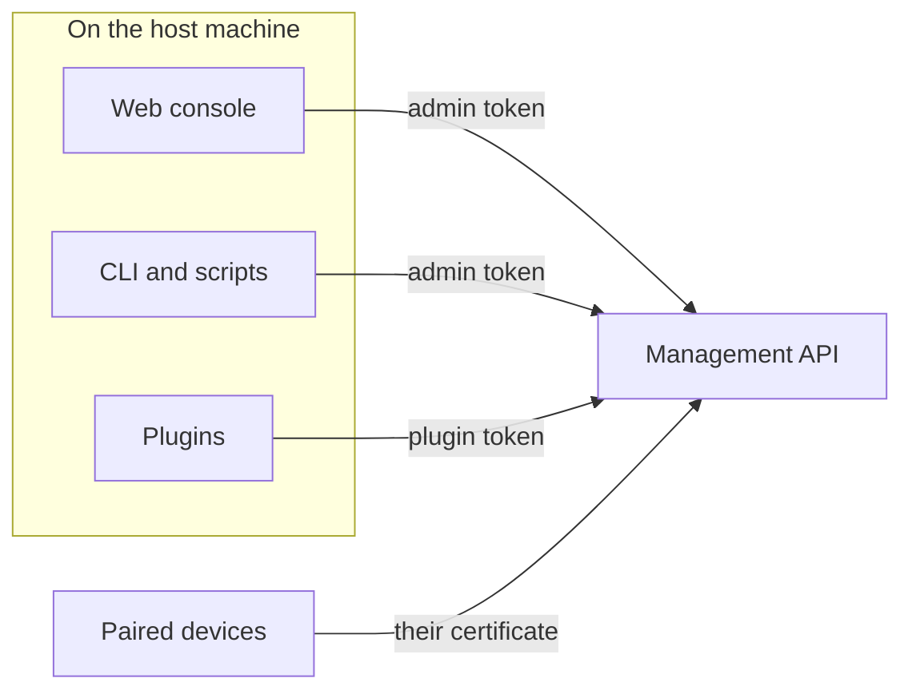

Every host serves a REST API, and everything that manages a host goes through it. Make a first
authenticated call here, then script the host with the typed SDK and its event stream. The full
endpoint reference is at [`/api`](/api).



## A first call

On the host, as the user that runs it:

```sh
. ~/.config/punktfunk/mgmt-endpoint   # sets PUNKTFUNK_MGMT_URL
. ~/.config/punktfunk/mgmt-token      # sets PUNKTFUNK_MGMT_TOKEN
curl -k -H "Authorization: Bearer $PUNKTFUNK_MGMT_TOKEN" "$PUNKTFUNK_MGMT_URL/api/v1/status"
```

On Windows, from an elevated PowerShell:

```powershell
$t = (Get-Content "$env:ProgramData\punktfunk\mgmt-token") -replace '^PUNKTFUNK_MGMT_TOKEN=', ''
curl.exe -k -H "Authorization: Bearer $t" https://127.0.0.1:47990/api/v1/status
```

`-k` is needed because the certificate is self-signed and names no host. The SDK pins it instead.
For shell scripts, [`punktfunk-host ctl`](/docs/host-cli#ctl) wraps the common calls and handles
the token and certificate for you.

## Where it listens

`https://<host>:47990/api/v1`, over HTTPS with the host's self-signed identity certificate.

- The listener binds all interfaces. Admin calls are accepted from loopback only; from the LAN,
  only a paired device gets in.
- Move it with `--mgmt-bind <IP:PORT>` or `PUNKTFUNK_MGMT_BIND` in `host.env`
  ([Host CLI](/docs/host-cli)). `127.0.0.1:47990` makes it loopback-only.
- On every start the host writes the URL it bound to `<config>/mgmt-endpoint`, as
  `PUNKTFUNK_MGMT_URL=https://127.0.0.1:<port>`. Read that instead of assuming 47990.

`<config>` is `~/.config/punktfunk` on Linux and `%ProgramData%\punktfunk` on Windows
(`PUNKTFUNK_CONFIG_DIR` overrides it).

## Credentials

Send a bearer token as `Authorization: Bearer <token>`. Which credential decides what you may
call:

| Credential | Comes from | Accepted from | May call |
|---|---|---|---|
| Admin token | `<config>/mgmt-token` | Loopback | Everything |
| Plugin token | `<config>/plugin-token`, minted while the plugin runner is installed | Loopback | The plugin allowlist |
| Per-plugin token | The runner hands one to each plugin | Loopback | The plugin allowlist, for its own registration and library provider only |
| Tray token | `<config>/tray-token`, minted fresh at every start; every local account but a seat's may read it | Loopback | `GET /local/summary` and nothing else |
| Paired device | A paired client certificate over mTLS, or a browser's device-key token | Anywhere | A short list of reads, and its own actions |

**The plugin allowlist** is status, library, sessions, displays, events and plugin registration.
Not hooks, pairing admin, host logs, the plugin store or updates.

**A paired device** reads host, status, compositors, actions, display targets, the library, and
the profile list and pictures. It may also:

- wake a profile's seat, and ask for a profile's unlock challenge;
- pick its own screen;
- install, pause and remove a library title;
- end its own game, and [start a game on the host's own screen](#start-a-game-on-the-hosts-own-screen)
  from the host's own machine;
- upload logs;
- invoke an action it holds the grant for.

The exact lists are code: `paired_may_access` in `crates/core/punktfunk-core/src/mgmt_routes.rs`
and `plugin_may_access` in `crates/host/punktfunk-host/src/mgmt/auth.rs`.

`GET /api/v1/health`, `GET /api/v1/webtransport`, the device-key exchange
(`POST /api/v1/auth/device/challenge` and `/token`), the spec and the reference UI need no
credential.

The token files hold one `KEY=<hex>` line (`PUNKTFUNK_MGMT_TOKEN=…`, `PUNKTFUNK_TRAY_TOKEN=…`),
so a shell or a systemd `EnvironmentFile` can source them. Send only the value after `=`. The
admin file is owner-only: your user on Linux, Administrators on Windows. To pin a token of your
own, see `PUNKTFUNK_MGMT_TOKEN` in [Configuration](/docs/configuration).

Errors come back as `{"error": "<message>"}` with the HTTP status. A message written for a person
also carries `code`, naming the host message `apierr_<code>`, and the `params` it is worded with.

## Events

`GET /api/v1/events` is a Server-Sent Events stream of host lifecycle events: clients, sessions,
streams, pairing, displays, library, updates. [Host events](/docs/host-events) has the event
catalogue, the frame format, resume with `Last-Event-ID`, and the `?kinds=` filter.

## TypeScript SDK

`@punktfunk/host` is a typed client for every endpoint plus the event stream, with reconnect and
resume. It lives in [`sdk/`](https://git.unom.io/unom/punktfunk/src/branch/main/sdk) and is
published to the unom npm registry:

```sh
echo '@punktfunk:registry=https://git.unom.io/api/packages/unom/npm/' >> .npmrc
bun add @punktfunk/host effect     # or: npm i @punktfunk/host effect
```

```ts
import { connect } from "@punktfunk/host";

const pf = await connect();
const host = await pf.api.getHostInfo();
console.log(`connected to ${host.hostname}`);

pf.events.on("pairing.pending", async (e) => {
  const pending = await pf.api.listPendingDevices();
  const match = pending.find((d) => d.fingerprint === e.device.fingerprint);
  if (match) await pf.api.approvePendingDevice(String(match.id), { payload: {} });
});
```

`connect()` needs no arguments on the host box. It resolves each setting in this order:

| Setting | Order |
|---|---|
| URL | `{ url }`, `PUNKTFUNK_MGMT_URL`, `<config>/mgmt-endpoint`, `https://127.0.0.1:47990` |
| Token | `{ token }`, `PUNKTFUNK_MGMT_TOKEN`, `PUNKTFUNK_PLUGIN_TOKEN`, `<config>/plugin-token` |
| Certificate pin | `{ ca }`, `PUNKTFUNK_MGMT_CA` (a path), `<config>/native-cert.pem`, `<config>/cert.pem` |

It never reads `mgmt-token` on its own. A script that needs admin routes, such as the pairing
approval above, sets `PUNKTFUNK_MGMT_TOKEN` or passes `{ token }`.

`pf.events.on()` takes an event kind, a `domain.*` prefix or `*`, plus `dropped` (you missed
events; re-read state over REST) and `unknown` (a kind newer than the SDK). It starts at the live
tail, and reconnects and resumes on its own.

| Import | For |
|---|---|
| `@punktfunk/host` | Promise API: `connect()`, `pf.api.*`, `pf.events.on()`, `pf.request()` for an untyped call |
| `@punktfunk/host/effect` | The same as Effect services, `Stream` events and typed errors |
| `@punktfunk/host/core` | The Effect surface without Node, for a browser; `deviceKey()` signs in with a paired key |

Runnable examples, from a one-screen event tail to a USB passthrough script:
[`sdk/examples`](https://git.unom.io/unom/punktfunk/src/branch/main/sdk/examples). Run one from
`sdk/` with `bun install && bun examples/tail-events.ts`. To keep code running on the host, package
it as a plugin ([Writing plugins](/docs/developers/writing-plugins)) or start the script from your
own systemd unit or scheduled task.

## Start a game on the host's own screen

`POST /api/v1/game/launch` with `{ "app_id": "steam:570" }` starts a library title on the host's own
screen, with no stream, as the owner profile. The admin token may call it. A paired device may with
the **Launch games** grant, and only from the host's own machine: a call over the network is
refused. `punktfunk-host ctl launch <ID>` calls it.

| Answer | Means |
|---|---|
| `202` `{"via":"host"}` | The host starts the title. |
| `202` `{"via":"steam"}` | Game Mode: the host asked Steam to run the title or its entry. |
| `200` `{"via":…,"running":true}` | The host already runs it. |
| `403` `device_not_allowed_to_start_games` | No launch grant, or a locked owner profile. |
| `403` `local_not_this_device` | The caller isn't on the host's own machine. |
| `404` `local_no_such_game` | The id isn't in the library. |
| `409` `local_no_desk` | A seat, or the owner's session while it runs in the background with nobody signed in at the box. |
| `409` `local_nobody_signed_in` | Windows: nobody is signed in. |
| `409` `local_no_session` | Linux: no desktop is running. |
| `409` `local_not_in_steam` | Game Mode: the title has no Steam entry. |

What follows rides `GET /api/v1/status`, as a `games[]` row with `plane: "local"` and
`client: "desk"`. Its `state` goes `launching`, `running`, `window`. For a minute after a launch
that was refused late or died at the start, the row reads `exited` with an `outcome` (`code` and
`params`, worded by the host message of that code). `POST /api/v1/game/end` with the `app_id` ends
it; a call with none leaves it. `GET /api/v1/host` says `local_play: true` when the host has a
screen for this. [Play on this device](/docs/play-on-this-device) covers what the apps do with it.

Game Mode adds routes for the Decky plugin and `punktfunk-host play`, on the admin token only:
`GET` and `PUT /api/v1/steam/entries` (the games that can become Steam entries, and the map from
library ids to Steam's app ids) and `POST /api/v1/game/handoff` with
`POST /api/v1/game/handoff/{token}` (an entry asks what to run, then reports that it started and
exited). A plugin token can't call them.

## Reference

- [`/api`](/api) on this site: the interactive reference, built from
  [`api/openapi.json`](https://git.unom.io/unom/punktfunk/src/branch/main/api/openapi.json).
- On a running host: `/api/docs` (the same reference) and `/api/v1/openapi.json` (the spec).
- `punktfunk-host openapi` prints the spec of that binary.

## Changing the API

Handlers live in `crates/host/punktfunk-host/src/mgmt/`. Annotate a new handler with
`#[utoipa::path]` and add it to `api_router_parts` in `crates/host/punktfunk-host/src/mgmt.rs`.
A route then needs a decision in each of these tables. A test pins every one of them to the API
document, so a route nobody classified fails the build.

| Decide | In | Pinned by |
|---|---|---|
| Whose the route is: the box's, one host's, or a profile's data or code | `SCOPES` in `mgmt/scope.rs` | `every_route_has_one_scope` |
| Whether a plugin or a paired device may call it | `plugin_may_access` in `mgmt/auth.rs`, `paired_may_access` in `punktfunk-core`'s `mgmt_routes.rs` | `every_route_is_classified_for_the_plugin_and_cert_lanes` |
| Which host answers it on a [door](/docs/developers/multi-seat-contract/door) | `DOOR` in `mgmt/owner.rs` | `every_route_has_a_side_on_the_door` |
| Whether the console asks for its password before a call that changes something | `web/server/util/gates.ts` | `gates.test.ts` |

The Rust tests are in `mgmt/tests/routes.rs`. The browser client's page server relays by
`paired_may_access`. The scopes are defined in
[`CONTEXT.md`](https://git.unom.io/unom/punktfunk/src/branch/main/CONTEXT.md).

Then:

1. Word each coded error as an `apierr_<code>` message in `l10n/messages/host/en.json`.
2. Regenerate the spec and every copy of it:

   ```sh
   cargo run -p punktfunk-host -- openapi > api/openapi.json
   cp api/openapi.json docs-site/public/openapi.json
   (cd sdk && bun install && bun run gen)
   cargo test -p punktfunk-host mgmt::
   ```

3. Commit all three generated files. CI fails when `api/openapi.json` differs from what the binary
   serves, when the docs-site copy differs, or when `sdk/src/gen/punktfunk.ts` is stale. The web
   console regenerates its client on `bun run dev` and `bun run build`.
4. Run the [`web/` and `sdk/` checks](/docs/developers/testing#javascript-packages) whole.
