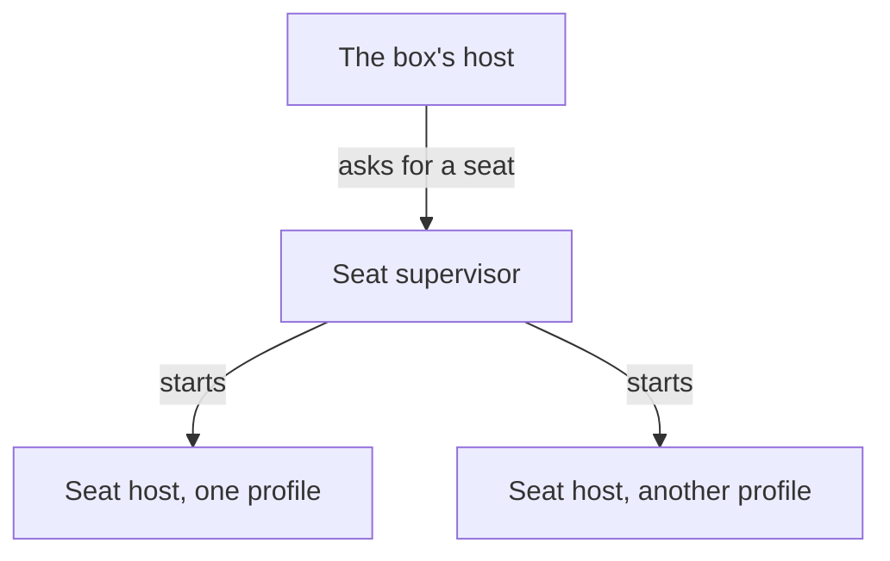
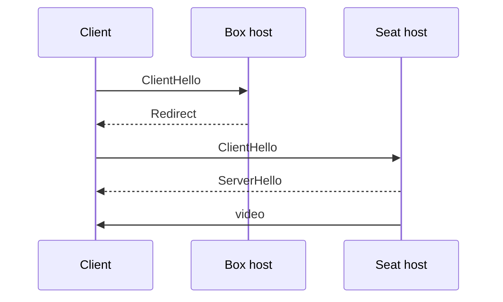

See how one box serves several players at once, each on a desktop of their own, before you read
or change the rules behind it. A normal install has one host, and none of this applies to it.
Setup and what players see: [Seats on Windows](/docs/windows-seats),
[Profiles](/docs/profiles#on-linux) and [Someone's own account](/docs/own-account).

## The idea

A seat is a second desktop on the same machine: its own OS account, its own session, and an
ordinary `punktfunk-host serve` of its own. A supervisor starts and stops those hosts, up to four.
The box's own host stays the one address clients know. It pairs devices, and it sends a player
whose profile has a seat on to that seat's host.

The `Redirect` names the seat's port and the fingerprint of its certificate, so the client pins
the seat through the box it already trusts.

## The words

| Word | Means |
|---|---|
| Box | The machine. What exists once belongs to it: identity, pairing, power, seats on or off. |
| Seat | A desktop of its own on the box, with its own account and host process. A seat serves one profile. |
| Profile | A player. One with a seat plays there; the others share the owner's desktop or take turns on it. |
| Operator | Whoever holds the console password. Changes what belongs to the box, and manages every profile. |
| Person | The human a profile stands for. The console password never runs code as them. |
| Made seat | A seat on an account the supervisor created for it. |
| Own account | A seat on an account the box already had: a family member's own login. |
| The door | Linux: the box's host as a system service, so the box answers with nobody logged in. |
| The owner's row | Linux: the seat the box's owner plays on. Behind a door the owner is a seat like any other, and that seat also serves the profiles that share the owner's desktop. |

The scopes behind these words are in
[`CONTEXT.md`](https://git.unom.io/unom/punktfunk/src/branch/main/CONTEXT.md).

## The two platforms

| | Windows | Linux |
|---|---|---|
| The box's host | The console host. It streams the desk and redirects profiles that have a seat. | The door, `serve --door`. It pairs and redirects, and never streams. |
| The supervisor | Inside the `PunktfunkHost` service | The root daemon `punktfunk-seats` |
| A seat is | A seat account's loopback Remote Desktop session | A system user with a logind session and a headless compositor |
| The owner plays | At the desk, on the console host | On the owner's row |
| Seats are on | Once an operator turns them on | While the daemon runs, behind a door |

## What a seat host shares, and what is its own

A seat host is the same binary as any host. The
[environment](/docs/developers/multi-seat-contract/supervisor#the-environment-a-seat-host-is-started-with)
the supervisor starts it with makes it a seat.

| A seat host | |
|---|---|
| Reads from the box, and never writes | The pairing store and profiles, the game library, the Seat defaults, its profile's lock |
| Keeps for itself | Its own certificate and key, its own titles, its play stats |
| Has to itself | One virtual display at the occupant's mode, its own virtual pads and audio devices |
| Never does | Pair a device, advertise itself, sleep or restart the box, run a tray |

## The contract

The pages below are the contract of record between the host and its supervisor. Each sentence
is a rule the code keeps, so change a page and the code it describes in the same pull request.

| Page | Rules for |
|---|---|
| [The supervisor](/docs/developers/multi-seat-contract/supervisor) | The control channel and its commands, the environment a seat host starts with, the check that a seat can stream |
| [What a seat host does differently](/docs/developers/multi-seat-contract/seat-host) | Its display, the Seat defaults, the box's trust and library, its own titles, a profile's layer |
| [A profile's lock](/docs/developers/multi-seat-contract/profile-locks) | Locks, PINs and device keys, and what a device that passes may change |
| [Windows seats](/docs/developers/multi-seat-contract/windows) | The service, seat accounts, the connector reservation, turning seats on, the two drivers |
| [Linux seats](/docs/developers/multi-seat-contract/linux) | The daemon, a seat's user, the trust and library copies, games, controllers |
| [The owner's row and the door](/docs/developers/multi-seat-contract/door) | What the door answers itself, how events cross, switching the door on and off |
| [A seat on a person's own account](/docs/developers/multi-seat-contract/own-account) | Adopting an account, the person's own session, which devices open the seat |

## Linux and Windows, side by side

A row with one answer holds on both. Every other row is a difference the contract pages state.

| What a profile has | Linux | Windows |
|---|---|---|
| Its own layer: hidden titles, sources, game overrides, session settings | Yes | Yes |
| Its lock, PIN and device key | The door checks | The box host checks |
| A device as its person, on `mgmt_routes::PERSON` | The door decides, the owner's host writes | The box host decides and writes |
| Its own titles, with a command and `prep` | On its seat host; the owner's host stores the list | On its seat host; the box host stores the list |
| [The person's own session](/docs/developers/multi-seat-contract/own-account#the-persons-own-session) | On a seat's own host, made or on their own account; the ticket from a `0600` file | The same; the ticket from the seat host's person pipe |
| What that session reaches on the seat host | Every `profile-data` and `profile-exec` route, and their plugins' pages | Their hooks, their own titles, the store, their runner, their plugins' pages and folder decisions |
| Hooks on a made seat | The operator and the person | The operator and the person |
| Hooks on a person's own account | The person, in their session | The person, in their session |
| Plugins on a made seat | The seat account's own runner | The seat's own runner, as the seat's account; its person installs from the built-in source alone |
| Plugins on a person's own account | Their seat's own runner, which the person alone switches and installs into, in their session | The same |
| The box's titles on its seat | Steam and emulator titles it can start as its own user | Every title but those of one account's sources |
| Emulators | Installed box-wide; config and saves are the account's | The box's copies; saves and firmware through the box host's `?profile=` |
| A controller plugged into the box | The desk's, or [lent](/docs/developers/multi-seat-contract/linux#lent-controllers) to one profile's seat | The desk's, or [lent](/docs/developers/multi-seat-contract/windows#lent-controllers) to one profile's seat |
| A seat on an existing account | Yes, opened by its password or a device key | On Windows Server |

A plugin with no listener of its own, as every Windows seat's is, serves its page through its seat
host's relay, which the person's session reaches.
