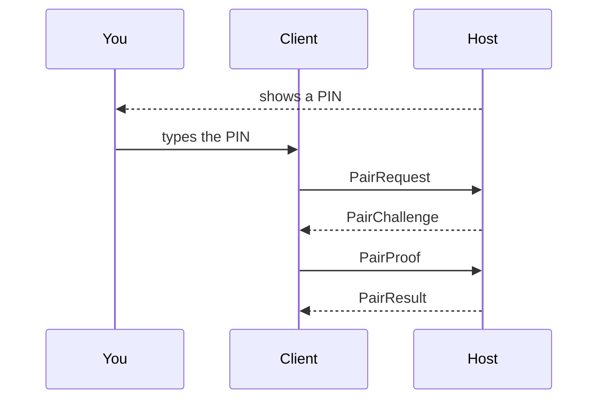
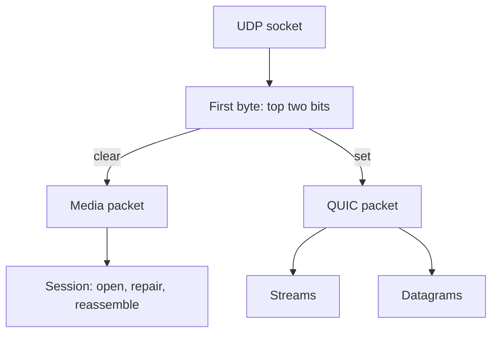
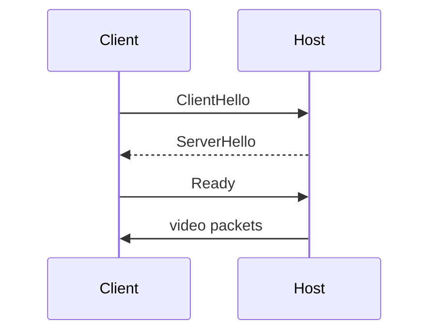
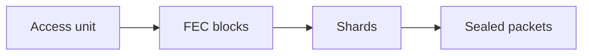
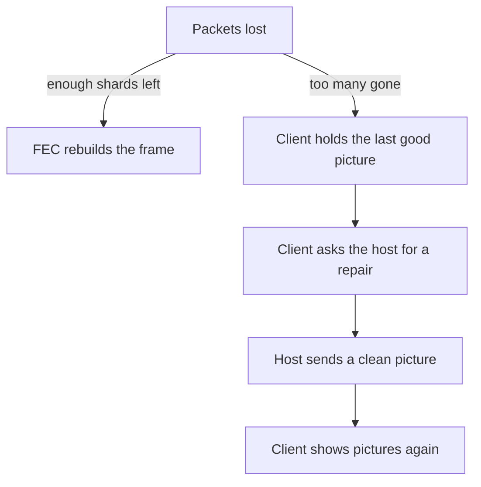

Learn what a client and a host say to each other, from the first pairing to a lost packet, so you
can change the protocol or debug a session. All of it is `punktfunk/2`, the native protocol, and
all of it lives in `crates/core/punktfunk-core`. Moonlight's GameStream is a separate plane in
the host.

## Trust comes first

Each side has a long-lived self-signed certificate, and its SHA-256 fingerprint is its identity.
There is no account, certificate authority or cloud. Pairing binds two fingerprints together
once:

The exchange is SPAKE2 with both fingerprints as its identities. The two sides agree only when
they share the PIN and saw the same two certificates, so someone in the middle gets one guess
and nothing to crack offline. Afterwards the host stores the client's fingerprint, the client
pins the host's, and every later connection is mutual TLS between those two.

A client can also skip the PIN: it connects with its certificate, and the operator approves it in
the console. What each proves is on [Security](/docs/security#what-protects-you).

## One port, two kinds of packet

A session uses one UDP port. QUIC carries everything that needs ordering or reliability. Video
rides beside it as raw packets on the same socket, so a frame never waits on a stream or enters
an async runtime.

A carrier with no raw UDP path, the browser's WebTransport, sends media as QUIC datagrams
instead.

## The handshake

The client opens the control stream and the two settle the session in three frames:

| Frame | Says |
|---|---|
| `ClientHello` | What the client is and wants: display mode, the codecs and colour formats it decodes, audio layout, gamepad type, a bitrate, a game to launch |
| `ServerHello` | What the host chose: mode, codec, bit depth and colour, FEC settings, packet size, audio format, the device's grants |
| `Ready` | The client's decoder and reassembler exist; send the first frame |

Build the decoder from what the host chose, never from what the client asked for. A capability
is in force only once one side offered it and the other agreed.

Both sides then derive the media keys from the TLS exporter of this connection. No key crosses
the wire.

The host can answer a `ClientHello` three other ways:

| Frame | Means |
|---|---|
| `Pending` | The operator is still deciding about this device. It repeats until they do. |
| `Redirect` | Dial this other address instead, pinned to the certificate it names. A host that runs [seats](/docs/developers/multi-seat-contract) sends a player to their seat's host this way. |
| `Refused` | Why the close that follows happens, as a code and a sentence the client shows. |

## What travels where

State goes into datagrams, where the newest one wins and a lost one is never resent. An event
that must not be lost goes on a stream.

| Traffic | Carrier | When a packet is lost |
|---|---|---|
| Video | Raw UDP, with error correction | Repaired, or [recovered](#when-packets-are-lost) |
| Audio, microphone, controller audio | QUIC datagram | Never resent |
| Pointer motion, sticks, scroll, touch moves | QUIC datagram | The next one replaces it |
| Key, button and text presses | Control stream | Resent |
| Rumble, lights, cursor position, HDR metadata, host timing | QUIC datagram | The next one replaces it |
| The client's receive reports and repair asks | QUIC datagram | Repeated a few times; the host acts once |
| Mode change, bitrate, clock sync, clipboard offers | Control stream | Resent |
| Clipboard contents and files | One QUIC stream per transfer | Resent |

## A frame on the wire

1. The encoder emits an access unit: one encoded frame.
2. The core splits it into blocks of packet-sized shards and adds recovery shards, with
   Leopard Reed–Solomon over GF(2¹⁶). A block survives losing as many shards as it has recovery
   shards.
3. Each shard is sealed into a packet with AES-128-GCM, or ChaCha20-Poly1305 for a client
   without hardware AES. The packet number is authenticated, and a sliding window drops replays.
4. The host paces the packets out on one clock, at the rate the link carries.
5. The client opens them, puts them in order, rebuilds missing shards and hands the decoder a
   whole access unit.

## When packets are lost

1. **Error correction** absorbs short losses. Nothing above the core notices.
2. **A frame that can't be rebuilt** would make every later frame wrong, because each one
   builds on the last. A hardware decoder conceals the gap and returns a gray picture, so the
   client holds the last good picture instead and asks the host for a repair.
3. **The host answers** with a clean picture, and which kind depends on its encoder: a recovery
   anchor (a frame built on an older reference the client still has), an intra-refresh wave that
   sweeps the picture clean over a few frames, or a keyframe.
4. **The client lifts the freeze** only on proof: a keyframe, an anchor that decoded, or the end
   of a wave that began after the loss.
5. **Loss that persists** is congestion. The adaptive bitrate controller asks the host for a
   lower rate.

PyroWave skips steps 2 to 4: every frame is a keyframe, so a loss costs one frame.

## While it streams

| Change | Frames | Result |
|---|---|---|
| A new resolution or refresh rate | `Reconfigure`, `Reconfigured` | The host rebuilds the display and the encoder; the first frame in the new mode is a keyframe |
| Adaptive bitrate | `SetBitrate`, `BitrateChanged` | The controller runs in the client's core, so every client decides alike |
| Clock sync | `ClockProbe`, `ClockEcho` | The clock offset between the two machines, which the latency figures need. Timestamps run on a per-session clock. |
| The operator changes a device's grants | `AccessUpdate` | The client learns its new grants. The host enforces them either way. |

## How the wire grows

- A frame is a type, a length and fields; a field is a tag, a length and a value. A reader skips
  a type or a tag it doesn't know, so a message grows by adding a tag. Nothing is positional.
- Every number on the wire is allocated in `quic/v2/registry.rs` and never reused. A test fails
  until a new one is in its table.
- The ALPN, `pkf2`, is the only breaking version. A client that offers an older one is closed
  with a code it shows as "update both".

## Read the code

Paths are under `crates/core/punktfunk-core/src/`.

| Concept | Where |
|---|---|
| Handshake values | `quic/handshake.rs`, `quic/caps.rs` |
| Pairing | `quic/pairing.rs`, `quic/pake.rs` |
| Every wire number | `quic/v2/registry.rs` |
| Control stream messages | `quic/control.rs` |
| Datagrams | `quic/datagram.rs`, `input.rs` |
| Packets and error correction | `packet/`, `fec/` |
| Sealing | `crypto.rs` |
| The two data-plane state machines | `session.rs` |
| The shared socket | `transport/shared.rs` |
| Loss recovery | `client/recovery.rs`, `reanchor.rs` |
| Adaptive bitrate | `abr/` |
| The client worker | `client/pump.rs` |
| A session's phases on the host | `crates/host/punktfunk-host/src/native.rs` |
