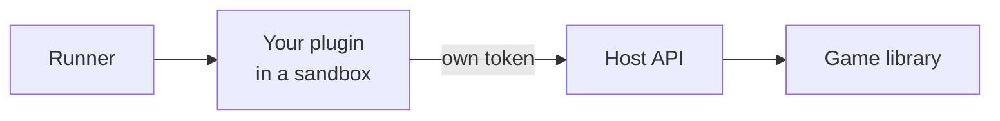
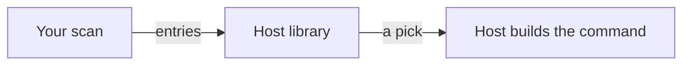

A plugin is an npm package that the host's plugin runner loads and supervises. Take one from an
empty folder to a package operators install from the console. Most plugins are library sources,
like [`punktfunk-plugin-steam`](https://git.unom.io/unom/punktfunk-plugin-steam);
[`punktfunk-plugin-rom-manager`](https://git.unom.io/unom/punktfunk-plugin-rom-manager) also has
its own console page.

| A plugin can | How |
|---|---|
| List games from a launcher or folder in every client's library | [A minimal library plugin](#a-minimal-library-plugin) |
| Fill in covers and details for games other plugins list | [A source of art and details](/docs/developers/writing-plugins/recipes#a-source-of-art-and-details) |
| Add a page to the console, or a tab to each game's page | [Recipes](/docs/developers/writing-plugins/recipes) |
| Do work before a game starts | [Hold a launch](/docs/developers/writing-plugins/recipes#hold-a-launch) |
| Download titles on demand | [Install a title](/docs/developers/writing-plugins/recipes#install-a-title) |
| React to host events | `definePlugin` from `@punktfunk/host` |

## How a plugin runs



The runner (`punktfunk-scripting`) starts every package listed in `<config>/plugins/package.json`
whose name is `@<scope>/plugin-*` or `punktfunk-plugin-*`. `<config>` is `~/.config/punktfunk` on
Linux and `%ProgramData%\punktfunk` on Windows.

- It imports the package's `module` (else `main`) entry. The default export must be a plugin
  definition.
- A crash restarts the plugin with backoff, from 1 s up to 60 s. A clean return ends it.
- On stop, the plugin's Effect fiber is interrupted, so scoped finalizers run.
- The plugin calls the [management API](/docs/developers/management-api) with a credential of its
  own. It reaches the plugin allowlist only: it can write its own library titles and registration,
  but not hooks, pairing, the plugin store, or a `command` launch.
- Lines it logs with `Effect.log` show on the console's **Troubleshooting** page as
  `plugin:<id>`.

| | Linux | Windows |
|---|---|---|
| Isolation | One bubblewrap sandbox per plugin, with its own PID namespace | One AppContainer per plugin, `punktfunk.plugin.<id>`, under the runner's `NT AUTHORITY\LocalService` account |
| Files | `/usr`, its own code, its state dir, the manifest's paths and the operator's grants | Program Files, its own code, its state dir, the manifest's paths and the operator's grants; user profiles are closed |
| Network | None unless the manifest sets `network`; on this computer only the ports the operator allowed | None unless the manifest sets `network`; never loopback |
| Host API | A socket the runner forwards; `connect()` finds it | A named pipe per plugin; `connect()` finds it |

What a plugin may touch is declared up front, in its
[manifest](/docs/developers/writing-plugins/manifest).

## A minimal library plugin

`@punktfunk/plugin-kit/library` supplies everything except the scan: the sync loop, file watching,
the console settings form and the CLI. Four files:

```json title="package.json"
{
  "name": "@you/plugin-hello",
  "version": "0.1.0",
  "type": "module",
  "module": "./dist/index.js",
  "bin": { "punktfunk-plugin-hello": "./dist/cli.js" },
  "files": ["dist"],
  "scripts": {
    "build": "bun build src/index.ts src/cli.ts --target=bun --outdir dist --external effect --external '@punktfunk/*'",
    "test": "bun test"
  },
  "dependencies": {
    "@punktfunk/host": "^0.6.0",
    "@punktfunk/plugin-kit": "^0.15.0",
    "effect": "4.0.1"
  },
  "punktfunk": {
    "schema": 1,
    "id": "hello",
    "reads": ["~/.local/share/hello"],
    "exec": {
      "play": { "exe": "hello-launcher", "args": ["{game}"], "params": { "game": "id" } }
    }
  }
}
```

```ts title="src/plugin.ts"
import * as fs from "node:fs";
import * as os from "node:os";
import * as path from "node:path";
import { Effect, Schema } from "effect";
import { defineLibraryPlugin } from "@punktfunk/plugin-kit/library";

const dir = () => path.join(os.homedir(), ".local/share/hello");
const db = () => path.join(dir(), "games.json");

export const plugin = defineLibraryPlugin({
  name: "hello",
  configSchema: Schema.Struct({}),
  detect: () => Effect.sync(() => fs.existsSync(db())),
  scan: () =>
    Effect.sync(() => {
      const games: { id: string; title: string }[] = JSON.parse(fs.readFileSync(db(), "utf8"));
      return games.map((g) => ({
        external_id: g.id,
        title: g.title,
        launch: { kind: "exec", value: "play", args: [{ name: "game", value: g.id }] },
      }));
    }),
  watchDirs: () => [dir()],
});
```

```ts title="src/index.ts"
import { plugin } from "./plugin.js";
export default plugin.def;
```

```ts title="src/cli.ts"
#!/usr/bin/env bun
import { plugin } from "./plugin.js";
await plugin.cli();
```

Before `bun install`, add `@punktfunk:registry=https://git.unom.io/api/packages/unom/npm/` to
`.npmrc`.

### What happens with it



- `detect` says whether the launcher is on this machine, and `scan` returns its games. The kit
  syncs every 15 minutes, and a few seconds after a folder in `watchDirs` changes.
- The host lists each title as `hello:<external_id>`.
- The plugin never starts a game. The host builds the command itself, from the `exec` template
  the manifest declared and the values the entry supplies.
- Other `launch` kinds cover the common launchers; the table is on `LaunchSpec` in
  [`plugin-kit/src/wire.ts`](https://git.unom.io/unom/punktfunk/src/branch/main/plugin-kit/src/wire.ts).
- Add `detect: { install_dir }` to a title whose launch hands off and exits, so the host can
  still tell when the game quits.

## Test it

Without a host, from your plugin's folder:

```sh
bun test
bun src/cli.ts detect           # present / absent
bun src/cli.ts scan --preview   # the entries a sync would send, as JSON
```

On a Linux host, install the packed tarball like any plugin. `plugins add` restarts the runner:

```sh
bun run build && bun pm pack --destination /tmp/pf-dev
punktfunk-host plugins add /tmp/pf-dev/you-plugin-hello-0.1.0.tgz --allow-public-registry
journalctl --user -u punktfunk-scripting -f
punktfunk-host plugins remove @you/plugin-hello   # when you're done
```

Any package outside the `@punktfunk` scope needs `--allow-public-registry`.

Before a release, guard your title ids. With the previous version installed,
`bun src/cli.ts parity --snapshot before.json` records what the host lists for your source;
`bun src/cli.ts parity --compare before.json` diffs your working copy's scan against it and exits
non-zero on any change. A changed id breaks pins and art caches on every client.

## Publish

1. Publish under a scoped name, `@<scope>/plugin-<id>`, to an HTTPS npm registry. The
   first-party repos publish from CI on a `v*` tag with `bun publish`.
2. From the public npm registry, operators can install it by name:
   `punktfunk-host plugins add @<scope>/plugin-<id> --allow-public-registry`. The console shows
   it as **Installed via CLI**.
3. To appear under **Browse** as **Verified**, open a pull request against
   [`punktfunk-plugin-index`](https://git.unom.io/unom/punktfunk-plugin-index): add an entry to
   `v1/index.json` pinning the exact `version` and the registry's `integrity` hash, then run
   `bun run validate`. unom reviews that tarball; each new version is a new pull request.
4. To run your own catalog, serve an `index.json` in the same format over HTTPS, with its ed25519
   signature at `<url>.sig`; the index repo's `tools/` generate a key and sign. Operators add it
   under **Plugins** → **Sources** with your public key. Its plugins install without the
   **Verified** badge, and an unsigned source is flagged.
